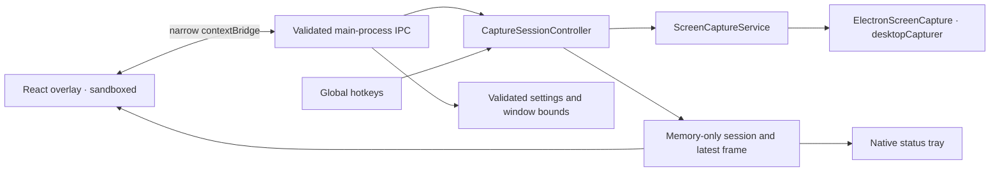

# EveryHint architecture — P1

## Process boundaries

The main process owns the window, native tray, hotkeys, consent, capture scheduler and persistence. React only renders controls, states and local previews. The sandboxed preload exposes a typed, fixed set of methods; it does not expose Electron, Node, arbitrary channels or the IPC event object.

The application is event driven except for the explicitly requested low-frequency screen sampling. State changes publish monotonically versioned snapshots to the overlay. A stale initial read cannot replace a newer event. No capture timer runs outside ACTIVE. Tray updates occur on state changes rather than on every frame.

## Modules

| Responsibility             | Implementation                                                                                                               |
| -------------------------- | ---------------------------------------------------------------------------------------------------------------------------- |
| Desktop window manager     | `src/main/index.ts`: frameless, draggable, resizable, always-on-top option, compact sizing, monitor-aware bounds restoration |
| Overlay UI                 | `src/renderer/src/main.tsx` and `styles.css`: response placeholder, controls, consent/source picker, diagnostics, settings   |
| Capture/consent controller | `src/main/session.ts`: authoritative state transitions and per-session consent                                               |
| Screen scheduler           | `src/main/capture.ts`: serial snapshots, timer disposal, generation-based cancellation                                       |
| Native screen adapter      | `src/main/electron-capture.ts`: source metadata, own-window filtering, local JPEG snapshots                                  |
| Hotkeys                    | `src/main/hotkeys.ts`: injectable registry and future binding overrides; status for each registration                        |
| Application settings       | `src/main/settings.ts`: validated versioned JSON with atomic replacement                                                     |
| Security                   | `src/main/security.ts` and main IPC/protocol handlers: exact document checks, local asset confinement and CSP                |
| Shared contracts           | `src/shared/contracts.ts`: IPC, screen, session, settings, future audio/transcription/context/AI interfaces                  |
| Runtime validation         | `src/shared/validation.ts`: untrusted IPC and disk inputs                                                                    |
| Preload bridge             | `src/preload/index.ts`: narrow API and removable snapshot listener                                                           |

There are no speculative AI adapters or dormant SDK dependencies in P1. The context engine, question detection, audio services and transcription implementation remain backlog items with boundaries defined by the shared contracts.

## State machine

| Current state                 | Allowed control                               | Result                                     |
| ----------------------------- | --------------------------------------------- | ------------------------------------------ |
| IDLE / STOPPED / ERROR        | Explicit consent, metadata selection, Prepare | READY                                      |
| READY                         | Prepare a listed source again                 | READY                                      |
| READY                         | Start                                         | ACTIVE                                     |
| ACTIVE                        | Pause                                         | PAUSED                                     |
| PAUSED                        | Resume with existing session consent          | ACTIVE                                     |
| Any                           | Stop / exit / lock / suspend                  | STOPPED; consent, source and frame cleared |
| Capture / enumeration failure | Automatic cleanup                             | ERROR; consent, source and frame cleared   |

Every new controller starts IDLE, even when settings exist. READY never schedules screenshots. Start and Resume require stored, validated consent plus a source from the main-process metadata list. Audio consent cannot be granted in P1. Stop is idempotent. A hotkey cannot start a new session; pause/resume is harmless when no authorised session exists.

Renderer reload stops an existing session. Renderer termination or unresponsiveness stops capture and surfaces ERROR. Application shutdown stops capture, unregisters shortcuts, persists window preferences and destroys the tray. Recovery never automatically resumes capture.

## Capture boundaries

P1 uses the supported main-process [`desktopCapturer.getSources`](https://www.electronjs.org/docs/latest/api/desktop-capturer) thumbnail API. This avoids a persistent full-frame-rate screen stream and keeps native capture and image encoding outside the UI renderer. Metadata enumeration requests a zero-size thumbnail. Active snapshots request only the selected source kind (`screen` or `window`) at 960 × 540; actual dimensions depend on Electron and the display. Only the selected source image is converted to JPEG and sent to the overlay. Images are never written to disk or passed to a provider.

This API enumerates a source kind rather than accepting a per-source thumbnail filter. Other sources of that kind may have short-lived native thumbnails created during the request. They are discarded, never retained as application context, and never sent to the renderer. A later capture transport can replace this adapter if strictly source-exclusive native acquisition or full-resolution capture is needed; this limitation must not be described as exclusive OS-level capture.

The scheduler allows at most one in-flight call, including across pause/resume generations. The next interval starts after the previous request completes. This avoids overlap and prioritises low resource usage over exact wall-clock cadence. Pausing and stopping synchronously cancel the timer and invalidate pending results. Electron has no cancellation API for an already issued thumbnail request: that one-shot native operation may finish after pause/stop, but its output is dropped and cannot revive the session. There are **no persistent MediaStream tracks** in this implementation.

EveryHint-owned window IDs are excluded from both selection and capture. Application-window screenshots can be previewed live. Entire-screen screenshots are previewed **only while PAUSED**, and the previous image is removed on resume before the next scheduled snapshot. EveryHint remains visible to normal screen sharing and monitoring; no content-protection or capture-evasion APIs are used.

Source disappearance, blank/minimised thumbnails, OS permission failures and native errors terminate the session with a visible error. Source IDs are session scoped. Window minimisation behaviour and conferencing applications' protected content vary by OS and need manual verification.

## Security and persistence

- `contextIsolation: true`, `nodeIntegration: false`, `sandbox: true`, `webSecurity: true`, no webviews or new windows.
- IPC checks the exact owning WebContents, its top-level frame, the trusted document URL and validated arguments. No generic IPC transport is exposed.
- Production uses `everyhint://app/index.html` with assets confined to the compiled renderer directory. Navigation, popups and renderer media permission requests are denied.
- Production CSP denies connections, inline/eval scripts, frames, media, objects and forms. Network requests outside the application origin are blocked by the Electron session as well. Development permits only the local Vite HTTP/WebSocket origin and inline code/styles required by React refresh.
- Only `{ version, settings, bounds }` are persisted. Unknown settings keys, invalid types, unsupported versions and unsafe intervals are rejected. Corrupt preferences restore safe defaults with a visible warning. Write failures propagate to the user.
- The native tray is created before the UI becomes usable; hiding is refused if that indicator is unavailable. Active capture is not tied to overlay visibility.

Implementation follows Electron's [security recommendations](https://www.electronjs.org/docs/latest/tutorial/security), [sandbox guidance](https://www.electronjs.org/docs/latest/tutorial/sandbox) and [global shortcut API](https://www.electronjs.org/docs/latest/api/global-shortcut).

## Future phases — contracts only

`AudioCaptureProvider` will deliver local PCM chunks and independently stop each source. `TranscriptionProvider` will emit partial/final transcript events. `ContextEvent` carries screen, transcript and question events; `AssistantResponse` carries streamed provider output. `AIProvider.respond` returns an abortable async iterable.

P4 will add Codex (`@openai/codex-sdk`) and Claude (`@anthropic-ai/claude-agent-sdk`) adapters after verifying their official authentication options at that time. Prefer supported subscription authentication; do not assume arbitrary OAuth token reuse or promise universal subscription availability. No authentication, provider SDK installation, AI requests or automatic provider selection is implemented in P1.
