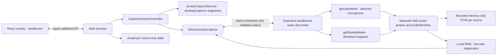

# EveryHint architecture — P1 + P2

## Process boundaries

P1's overlay, window manager, screen adapter, settings and hotkey controller remain intact. Main owns consent and orchestration. Browser media APIs run in `audio.html`, a separate hidden, sandboxed BrowserWindow with an in-memory Electron session. The capture context is dedicated to processing; the visible overlay and tray disclose actual activity. No content-protection or screen-sharing evasion APIs are used.

No capture window or media acquisition exists at startup. A temporary audio context can enumerate microphone metadata after explicit microphone consent; it is destroyed when the list is returned. An active session uses one capture window for its authorised audio sources. Duplicate operations are rejected.

## Modules

| Module                                       | Responsibility                                                                                                                               |
| -------------------------------------------- | -------------------------------------------------------------------------------------------------------------------------------------------- |
| `src/main/index.ts`                          | Window/tray/hotkeys, strict overlay IPC, per-session local protocol/CSP/network policy, lock/suspend/shutdown cleanup                        |
| `src/main/session.ts`                        | Authoritative session, consent, selected devices, per-source states and stale-event rejection                                                |
| `src/main/capture.ts`, `electron-capture.ts` | Existing serial screen snapshots and own-window exclusion                                                                                    |
| `src/main/audio-host.ts`                     | Capture-window lifetime, exact worker identity checks, native permissions, Windows display-media grant, startup deadline and forced teardown |
| `src/main/audio-permissions.ts`              | Testable microphone/display permission rules; deny camera, subframe and unrelated access                                                     |
| `src/preload/index.ts`, `audio.ts`           | Separate narrow overlay and capture bridges; no unrestricted Node/Electron/IPC access                                                        |
| `src/renderer/audio/engine.ts`               | Separate MediaStreams, track/device events, Web Audio graphs, local buffers/meters and complete browser-side disposal                        |
| `src/renderer/audio/worklet.ts`              | Native-rate PCM packet production; zero output, acknowledgement-based backpressure                                                           |
| `src/shared/audio.ts`, `audio-ipc.ts`        | RMS, bounded buffers/packets, typed worker protocol and runtime report validation                                                            |
| `src/shared/contracts.ts`, `validation.ts`   | Public IPC, session/source/PCM contracts and strict input validation                                                                         |
| `src/renderer/src/main.tsx`, `styles.css`    | Source consent/selection, independent meters, mute, diagnostics, original overlay/settings                                                   |

## Session and source state

The session retains IDLE, READY, ACTIVE, PAUSED, STOPPED and ERROR. Every launch starts IDLE. Each source has DISABLED, AVAILABLE, STARTING, CAPTURING, PAUSED, STOPPED or ERROR. AVAILABLE means explicitly prepared; OS access is confirmed during acquisition. ACTIVE may contain STARTING audio sources, so the overlay and tray distinguish starting from capturing.

All seven nonempty combinations of Screen/Microphone/System audio are supported. Every consent field must be a real boolean, at least one source must be enabled, and participant acknowledgement must be true. Screens require an enumerated source; nondefault microphones require an enumerated device ID. Audio-only sessions never start the screen scheduler. Disabled sources cannot start through hotkeys, media grants or reports.

Pause cancels the screen timer, invalidates late events, clears screenshots and destroys the audio capture window. Source consent/device selection and an explicit microphone mute are retained for resume. Resume recreates the browser context and checks permissions. Stop additionally clears consent, selections and buffers; fresh preparation is mandatory. Epochs prevent events from old contexts from updating the current UI.

A source failure stops the whole session rather than silently continuing a partial conversation capture. The failed source is ERROR, other selected sources become STOPPED, levels/frame are cleared, and consent is revoked. Windows lock, suspend, overlay reload, renderer crash/unresponsiveness, application shutdown and capture-context failures also stop resources. Nothing resumes after restart, unlock or system wake automatically.

## Audio acquisition

Microphone capture uses `getUserMedia` with `video: false` and an explicit device constraint. Windows default and communications aliases are supported. Echo cancellation and noise suppression are requested; automatic gain control is disabled. Native microphone privacy denial, unavailable devices and startup failures are surfaced.

System audio uses Electron's [`setDisplayMediaRequestHandler`](https://www.electronjs.org/docs/latest/api/session#sessetdisplaymediarequesthandlerhandler-opts) with `audio: 'loopback'`, never `loopbackWithMute`. This preserves speaker playback. Only a currently authorised, exact top-level audio worker can receive this grant, once per activation. Camera access is denied. Screen metadata is enumerated without thumbnails to satisfy Chromium's accompanying-video requirement. The returned video track is stopped and removed immediately; it is never attached to a video element/canvas, analysed or sent to the screen service.

There is one independent audio graph per source: MediaStream source → AudioWorklet → zero-filled output. No captured sound is replayed to speakers. There is no mixing of microphone and loopback. Browser track `mute`, `unmute`, `ended`, context state and media-device changes are handled. EveryHint's own mute toggles only its microphone track; it survives pause/resume. A silent meter does not claim to know a hardware switch or another application's mute state. See [MediaStreamTrack mute semantics](https://developer.mozilla.org/en-US/docs/Web/API/MediaStreamTrack/mute_event).

Input removal/default-device identity changes and observed output-device changes terminate capture and require explicit preparation. Driver and Windows routing notifications are imperfect: a session should be restarted after manual output changes even if no event arrives. There is no unsupported promise to exclude specific apps or remove acoustic/Windows-monitoring duplicates.

## PCM, buffering and diagnostics

`AudioFrame` defines source ID, stream UUID, sequence, timestamp (epoch milliseconds), sample rate, channel count, `f32-interleaved` samples and lifecycle (`started`, `data`, `stopped`). P2 produces data frames and uses new stream IDs plus context lifetime to delimit each activation; lifecycle marker values are reserved for future consumers. No transcription consumer exists yet.

AudioWorklets packetise 4096 sample frames, preserving up to two channels and the AudioContext sample rate. There is no 16 kHz resampler, speech model or speech recognition. This format can later be converted to mono 16 kHz PCM for whisper.cpp. Browser-required input-rate conversion is handled by Web Audio. See [AudioWorklet processing](https://developer.mozilla.org/en-US/docs/Web/API/AudioWorkletProcessor/process).

Per-source caches enforce **2 seconds, 32 packets and 768,000 bytes**; old/oversized packets are dropped. Each worklet allows one unacknowledged packet and drops input while waiting, preventing unbounded MessagePort queues. This is bounded diagnostic capture, not a lossless recorder. Muting clears its buffer. Pause/Stop destroy the context and clear both buffers.

RMS is computed locally. The worker reports at 200 ms intervals (5 Hz per source), with immediate structural/mute changes. Main sends small meter events separately from full snapshots, so screen images are not resent with every meter update. Two enabled sources can produce up to ten small overlay meter events per second. CSS smooths meters. Missing packets zero the displayed level after 600 ms.

Normal engine disposal stops every media track, disconnects nodes, closes worklet ports and AudioContexts, removes listeners, clears timers and releases buffers, including resources whose worklet is still loading. Main always destroys the BrowserWindow on pause/stop/failure, releasing browser-owned media even if JavaScript is unresponsive or acquisition is pending. Late promises cannot restart capture. Startup has a 20-second deadline.

## Screen capture and pause fix

P1 uses [`desktopCapturer.getSources`](https://www.electronjs.org/docs/latest/api/desktop-capturer) native thumbnails, initially every three seconds, at approximately 960 × 540. Only the selected image is retained and delivered to the overlay. Native enumeration can transiently thumbnail other sources of the chosen kind; this is not exclusive per-window OS acquisition. Already issued one-shot native requests cannot be cancelled, but late output is discarded immediately after pause/stop.

The reported P1 paused screenshot was a retained preview: the scheduler was already stopped. Commit `ee3fc00` clears that frame on pause. Application-window previews remain live while ACTIVE. Whole-screen previews stay hidden to prevent recursion and are also cleared when paused/stopped; no paused image is retained. Main-process tests verify the absence of further scheduled captures.

## Security and storage

Both UI and capture contexts use context isolation, sandboxing, disabled Node integration/webviews, denied navigation/popups and confined application assets. Worker IPC validates the exact WebContents, top-level frame and document URL; reports reject unknown fields, excessive sizes, invalid levels and unconsented sources. Worker configuration/activation cannot be invoked by the overlay. User activation for `getDisplayMedia` is granted through one fixed main-process function call following an authorised Start/Resume.

The overlay session denies all media permissions. The separate in-memory audio session grants only the consented source types in the current operation and denies cameras/unrelated permissions. Production network access is blocked by CSP and session request policy. AudioWorklet scripts are permitted only from the capture document's own origin. Development additionally permits the loopback Vite origin. See [Electron security](https://www.electronjs.org/docs/latest/tutorial/security).

Only validated versioned appearance settings, screen interval and bounds are written to disk. Consent, selected devices, screenshots, raw PCM, transcripts and credentials are never persisted. No provider SDK, authentication, native WASAPI module, audio storage/upload, analytics, model download or P3 transcription was introduced.
