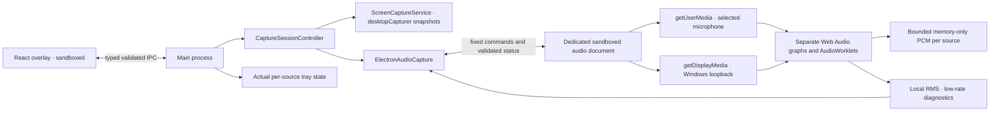
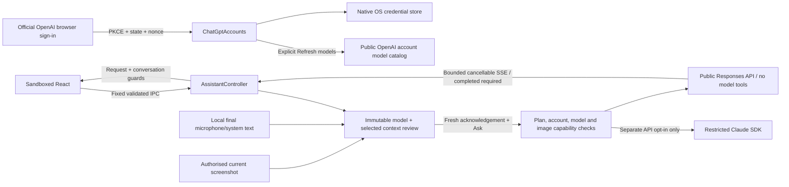

# EveryHint architecture — P1 + P2 + P3

## Process boundaries

P1's overlay, window manager, screen adapter, settings and hotkey controller remain intact. Main owns consent and orchestration. Browser media APIs run in `audio.html`, a separate hidden, sandboxed BrowserWindow with an in-memory Electron session. The capture context is dedicated to processing; the visible overlay and tray disclose actual activity. No content-protection or screen-sharing evasion APIs are used.

No capture window or media acquisition exists at startup. A temporary audio context can enumerate microphone metadata after explicit microphone consent; it is destroyed when the list is returned. An active session uses one capture window for its authorised audio sources. Duplicate operations are rejected.

## Modules

| Module                                       | Responsibility                                                                                                                               |
| -------------------------------------------- | -------------------------------------------------------------------------------------------------------------------------------------------- |
| `src/main/index.ts`                          | Window/tray/hotkeys, strict overlay IPC, per-session local protocol/CSP/network policy, lock/suspend/shutdown cleanup                        |
| `src/main/session.ts`                        | Authoritative session, consent, selected devices, per-source states and stale-event rejection                                                |
| `src/main/capture.ts`, `electron-capture.ts` | Existing serial screen snapshots and own-window exclusion                                                                                    |
| `src/main/audio-host.ts`                     | Capture-window lifetime, exact worker identity checks, native permissions, Windows display-media grant, startup deadline and forced teardown |
| `src/main/audio-permissions.ts`              | Testable microphone/display permission rules; deny camera, subframe and unrelated access                                                     |
| `src/preload/index.ts`, `audio.ts`           | Separate narrow overlay and capture bridges; no unrestricted Node/Electron/IPC access                                                        |
| `src/renderer/audio/engine.ts`               | Separate MediaStreams, track/device events, Web Audio graphs, local buffers/meters and complete browser-side disposal                        |
| `src/renderer/audio/worklet.ts`              | Native-rate PCM packet production; zero output, acknowledgement-based backpressure                                                           |
| `src/shared/audio.ts`, `audio-ipc.ts`        | RMS, bounded buffers/packets, typed worker protocol and runtime report validation                                                            |
| `src/shared/contracts.ts`, `validation.ts`   | Public IPC, session/source/PCM contracts and strict input validation                                                                         |
| `src/renderer/src/main.tsx`, `styles.css`    | Source consent/selection, independent meters, mute, diagnostics, original overlay/settings                                                   |

## Session and source state

The session retains IDLE, READY, ACTIVE, PAUSED, STOPPED and ERROR. Every launch starts IDLE. Each source has DISABLED, AVAILABLE, STARTING, CAPTURING, PAUSED, STOPPED or ERROR. AVAILABLE means explicitly prepared; OS access is confirmed during acquisition. ACTIVE may contain STARTING audio sources, so the overlay and tray distinguish starting from capturing.

All seven nonempty combinations of Screen/Microphone/System audio are supported. Every consent field must be a real boolean, at least one source must be enabled, and participant acknowledgement must be true. Screens require an enumerated source; nondefault microphones require an enumerated device ID. Audio-only sessions never start the screen scheduler. Disabled sources cannot start through hotkeys, media grants or reports.

Pause cancels the screen timer, invalidates late events, clears screenshots and destroys the audio capture window. Source consent/device selection and an explicit microphone mute are retained for resume. Resume recreates the browser context and checks permissions. Stop additionally clears consent, selections and buffers; fresh preparation is mandatory. Epochs prevent events from old contexts from updating the current UI.

A source failure stops the whole session rather than silently continuing a partial conversation capture. The failed source is ERROR, other selected sources become STOPPED, levels/frame are cleared, and consent is revoked. Windows lock, suspend, overlay reload, renderer crash/unresponsiveness, application shutdown and capture-context failures also stop resources. Nothing resumes after restart, unlock or system wake automatically.

## Audio acquisition

Microphone capture uses `getUserMedia` with `video: false` and an explicit device constraint. Windows default and communications aliases are supported. Echo cancellation and noise suppression are requested; automatic gain control is disabled. Native microphone privacy denial, unavailable devices and startup failures are surfaced.

System audio uses Electron's [`setDisplayMediaRequestHandler`](https://www.electronjs.org/docs/latest/api/session#sessetdisplaymediarequesthandlerhandler-opts) with `audio: 'loopback'`, never `loopbackWithMute`. This preserves speaker playback. Only a currently authorised, exact top-level audio worker can receive this grant, once per activation. Camera access is denied. Screen metadata is enumerated without thumbnails to satisfy Chromium's accompanying-video requirement. The returned video track is stopped and removed immediately; it is never attached to a video element/canvas, analysed or sent to the screen service.

There is one independent audio graph per source: MediaStream source → AudioWorklet → zero-filled output. No captured sound is replayed to speakers. There is no mixing of microphone and loopback. Browser track `mute`, `unmute`, `ended`, context state and media-device changes are handled. EveryHint's own mute toggles only its microphone track; it survives pause/resume. A silent meter does not claim to know a hardware switch or another application's mute state. See [MediaStreamTrack mute semantics](https://developer.mozilla.org/en-US/docs/Web/API/MediaStreamTrack/mute_event).

Input removal/default-device identity changes and observed output-device changes terminate capture and require explicit preparation. Driver and Windows routing notifications are imperfect: a session should be restarted after manual output changes even if no event arrives. There is no unsupported promise to exclude specific apps or remove acoustic/Windows-monitoring duplicates.

## PCM, buffering and diagnostics

`AudioFrame` defines source ID, stream UUID, sequence, timestamp (epoch milliseconds), sample rate, channel count, `f32-interleaved` samples and lifecycle (`started`, `data`, `stopped`). P2 produces data frames and uses new stream IDs plus context lifetime to delimit each activation; P3 adds a gated consumer. Lifecycle marker values are also accepted by the conversion pipeline.

AudioWorklets packetise 4096 sample frames, preserving up to two channels and the AudioContext sample rate. P3 performs separate mono/16 kHz conversion after explicitly enabled PCM forwarding. Browser-required input-rate conversion is handled by Web Audio. See [AudioWorklet processing](https://developer.mozilla.org/en-US/docs/Web/API/AudioWorkletProcessor/process).

Per-source caches enforce **2 seconds, 32 packets and 768,000 bytes**; old/oversized packets are dropped. Each worklet allows one unacknowledged packet and drops input while waiting, preventing unbounded MessagePort queues. This is bounded diagnostic capture, not a lossless recorder. Muting clears its buffer. Pause/Stop destroy the context and clear both buffers.

RMS is computed locally. The worker reports at 200 ms intervals (5 Hz per source), with immediate structural/mute changes. Main sends small meter events separately from full snapshots, so screen images are not resent with every meter update. Two enabled sources can produce up to ten small overlay meter events per second. CSS smooths meters. Missing packets zero the displayed level after 600 ms.

Normal engine disposal stops every media track, disconnects nodes, closes worklet ports and AudioContexts, removes listeners, clears timers and releases buffers, including resources whose worklet is still loading. Main always destroys the BrowserWindow on pause/stop/failure, releasing browser-owned media even if JavaScript is unresponsive or acquisition is pending. Late promises cannot restart capture. Startup has a 20-second deadline.

## Screen capture and pause fix

P1 uses [`desktopCapturer.getSources`](https://www.electronjs.org/docs/latest/api/desktop-capturer) native thumbnails, initially every three seconds, at approximately 960 × 540. Only the selected image is retained and delivered to the overlay. Native enumeration can transiently thumbnail other sources of the chosen kind; this is not exclusive per-window OS acquisition. Already issued one-shot native requests cannot be cancelled, but late output is discarded immediately after pause/stop.

The reported P1 paused screenshot was a retained preview: the scheduler was already stopped. Commit `ee3fc00` clears that frame on pause. Application-window previews remain live while ACTIVE. Whole-screen previews stay hidden to prevent recursion and are also cleared when paused/stopped; no paused image is retained. Main-process tests verify the absence of further scheduled captures.

## Security and storage

Both UI and capture contexts use context isolation, sandboxing, disabled Node integration/webviews, denied navigation/popups and confined application assets. Worker IPC validates the exact WebContents, top-level frame and document URL; reports reject unknown fields, excessive sizes, invalid levels and unconsented sources. Worker configuration/activation cannot be invoked by the overlay. User activation for `getDisplayMedia` is granted through one fixed main-process function call following an authorised Start/Resume.

The overlay session denies all media permissions. The separate in-memory audio session grants only the consented source types in the current operation and denies cameras/unrelated permissions. Production renderer network access is blocked by CSP and session request policy. AudioWorklet scripts are permitted only from the capture document's own origin. Development additionally permits the loopback Vite origin. See [Electron security](https://www.electronjs.org/docs/latest/tutorial/security).

EveryHint persists validated appearance/speech settings, screen interval/bounds and explicitly installed public model/runtime files. It does not persist capture consent, devices, screenshots, raw PCM, transcripts, questions or answers. Explicit ChatGPT sign-in is intentionally persisted by the official client in the OS credential store using EveryHint's private profile; application code and the renderer never read tokens. Provider-managed authentication/caches and remote retention are separate; P4 details follow below. No raw-audio upload, custom native WASAPI module or P5 automatic requests are introduced.

## P3 transcription pipeline

```mermaid
flowchart LR
  P2[P2 AudioWorklet PCM] --> Gate[Explicit run token · bounded IPC]
  Gate --> Validate[Main: frame/source/session validation]
  Validate --> Convert[Per-source mono + 16 kHz FIR conversion]
  Convert --> VAD[Independent energy gate and segmenter]
  VAD --> Queue[Fair queue · four waiting jobs maximum]
  Queue --> Native[One CPU whisper.cpp helper · stdin/stdout]
  Native --> Text[Bounded provisional/final transcript store]
  Text --> Panel[Live panel and compact status]
```

The [decision record](DECISIONS/P3-transcription.md) documents the official C API choice and alternatives. A pinned whisper.cpp v1.9.5 source commit is compiled into `everyhint-transcriber.exe`. The helper calls `whisper_init_from_file_with_params` once, with GPU disabled, then sequential `whisper_full` calls. `no_context` prevents one source's recognition prompt from contaminating the other. The standalone whisper-stream recorder is not used. No HTTP listener or native Node binding is needed. See the [official C API](https://github.com/ggml-org/whisper.cpp/blob/v1.9.5/include/whisper.h).

### Consent, routing and cancellation

Transcription starts OFF every launch. Enable requires ACTIVE capture, a session UUID, consent acknowledgement and at least one capturing audio source. It never activates media. Main sends a random run token to the existing audio context; only then does it forward PCM. One pending invoke per source bounds transport. Host validates exact worker/frame identity, token, source consent and sample metadata. Disabled/old tokens return no acceptance. Muted inputs send zeros rather than their raw samples, allowing existing speech to finalise without revealing muted input.

Worklet timestamps use the audio sample clock, anchored to epoch time at the first packet, rather than relying on delivery-time spacing. Input/OS latency and initial anchoring are approximate; subsequent relative sample times are preserved. Gaps, out-of-order sequences, changed formats/streams and timestamp jumps reset conversion and split segmentation. Already dropped P2 samples cannot be recovered.

Pause, Stop, Clear, model/settings changes, capture epoch changes, crashes and shutdown revoke the token, release queues/segmentation buffers, remove provisional text and kill the helper. Session UUIDs, run generations, stable utterance IDs and numeric helper job IDs reject late results. Capture Resume does not automatically resume transcription. Clear leaves transcription paused. Final text remains only until explicit clear, expiry or a new prepared session. A scheduled expiry also removes old text when no new audio arrives.

### Models and setup

`resources/speech-models.json` pins the publisher repository revision, exact sizes and SHA-256 LFS object hashes for tiny.en (77,704,715 bytes) and base.en (147,964,211 bytes). Sources are the [whisper.cpp model repository](https://huggingface.co/ggerganov/whisper.cpp) linked by [official model instructions](https://github.com/ggml-org/whisper.cpp/blob/v1.9.5/models/README.md). Downloads only occur through explicit Install/Reinstall or the model CLI. Data streams to a temporary file, with an exact size cap and streaming checksum; replacement happens only after verification. Every enable revalidates the model before loading. No remote inference fallback exists.

Settings display installed/missing/invalid/verifying/downloading status and progress. Corrupt speech configuration restores safe defaults with a visible message. Default paths are `%LOCALAPPDATA%\EveryHint\speech\runtime` and `models`, with an explicit root override. CMake source/build cache is outside Git. Runtime build instructions are in README; the default x64 CPU backend uses AVX2/FMA/F16C/BMI2, while ARM64 and alternative CPU builds require acceptance. Base.en installation/model switching are implemented, but only tiny.en inference was exercised here.

### Conversion, speech activity and bounds

PCM validation accepts mono/stereo float32, 8–192 kHz, at most 8192 finite normalised samples per packet. Downmix averages channels. A stateful 32-tap windowed-sinc filter performs anti-alias resampling to 16 kHz. Its bounded 256-phase coefficient cache is at most 64 KiB per source; this avoids repeated trigonometric work. Filter look-ahead is 16 input samples; timestamps refer to the logical resampled audio timeline.

The lightweight energy gate processes 20 ms blocks, retains 200 ms pre-roll and requires 200 ms of voiced energy before scheduling recognition. Defaults: RMS threshold 0.012, 900 ms silence, 12-second maximum speech, 400 ms overlap. UI settings expose conservative ranges: threshold 0.003–0.08, silence 600–2500 ms, max segment 10–15 seconds, overlap 0–1000 ms. It is a noise-sensitive energy gate, not a neural VAD, speaker identifier or question detector.

Partials use the current bounded utterance window, first after roughly 2.5 seconds and then at least 2.5 seconds of new audio. Silence or the maximum duration produces a final job. Short input is zero-padded to one second for inference, without extending its displayed audio timestamps. Partials replace the same event ID; finals replace provisional text. Limited max-boundary overlap is deduplicated by matching normalised multiword suffix/prefix text. This is conservative text deduplication, not token-perfect alignment.

| Resource                       | Limit / policy                                                                                                              |
| ------------------------------ | --------------------------------------------------------------------------------------------------------------------------- |
| Original P2 caches             | Unchanged: 2 seconds, 32 packets, 768,000 bytes per source                                                                  |
| P3 segment accumulation        | 10–15 seconds mono float32 (default 12); bounded pre-roll/remainder                                                         |
| Resampler history/kernel cache | Small FIR history and at most 64 KiB coefficients per source                                                                |
| PCM transport                  | One outstanding frame per source; dropped packet spacing is detected                                                        |
| Inference                      | One helper/model and one in-flight job; two waiting jobs per source (four total)                                            |
| Queue overload                 | Replace queued obsolete partials; finals supersede queued partials; drop older queued work with a visible counter when full |
| Helper request/output          | At most 240,000 samples (15 seconds) per job; stdout accumulator capped at 64 KiB                                           |
| Transcript store               | Default 15 minutes/200 events; configurable 1–60 minutes/20–500 events; hard 50,000-character cap                           |

Round-robin source scheduling prevents starvation. Inference never runs in Electron main or React. Native startup/inference requests have a 60-second deadline. Helper spawning uses fixed local paths, argument arrays, no shell and hidden process windows. Models are released on cancellation instead of reloaded per segment. Small transcript snapshots use separate IPC, avoiding repeated screen-image transfer.

The diagnostics panel reports measured model load time, average inference latency, queue length, dropped jobs, gaps, helper CPU and working set. CPU is expressed as a percentage of one logical core and may exceed 100%; measurements cover the helper, not the entire application. Full Windows hardware, long-run memory stability and a 15-minute real conversation remain pending in TESTING.md.

## P4.2 -- reviewed ChatGPT plan responses

`AssistantController` in Electron main owns provider selection, frozen review IDs, conversation IDs, one active request and deadlines. The registered providers are now `ChatGptProvider` (direct Responses) and the existing restricted Claude API adapter. The legacy internal ID `codex` is kept for IPC compatibility; it does not mean the Codex runtime executes an answer. The obsolete, blocked SDK adapter and CLI login actor remain unused by application wiring. See [the P4.2 decision](DECISIONS/P4.2-chatgpt-plan.md), which supersedes P4.1's native-login prototype.

### Authentication boundary

`main/ai/plan/accounts.ts` binds a stable per-installation public host ID to up to four OS-protected registrations. New registration and returning sign-in use the official SIWC flow. A loopback listener starts before opening the browser. Fresh cryptographic state, nonce and PKCE bind one callback to that attempt; issuer, RS256 signatures, audience, expiry, subject and issued client are checked with `jose`. An identity-only connection cannot obtain models or send an answer. Plan scopes must be granted and match the verified access JWT. Unknown accounts, mismatched subjects/client IDs, declined consent and malformed callbacks fail closed. Neither browser URLs nor credentials are sent to React.

`vault.ts` uses asynchronous native `@napi-rs/keyring` entries. The full registration/token record is split into 2,000-byte chunks beneath Windows' per-entry limit, with a 128 KiB aggregate bound. A hashed manifest commits the complete generation. Writes are serialized; older chunks are removed after commit. Crashes/deletion failures can leave OS-protected orphan chunks. No credential file, localStorage token or API-key fallback exists. Only a nonsecret `host-id` file lives in `userData/chatgpt-plan`; old Codex credentials are untouched.

Restore and Check connection read local state only. Token refresh occurs near expiry during explicit Refresh models or Ask, with the issued client/resource and no scope parameter. Rotating token sets are committed before exposure. Terminal refresh errors require reconnection; transient errors preserve the session. Sign-out attempts official-discovery token revocation with a ten-second bound and removes local tokens while retaining registration identity. Failure to confirm remote revocation is visible. Login has a five-minute deadline. Cancellation/generation checks protect account changes, provider changes, reload/crash, lock/suspend and quit.

### Model and inference boundary

Refresh models explicitly authorises GET `https://api.openai.com/v1/models`. Only visible entries from its documented `models` array are offered in server order. The five-minute in-memory catalog belongs to one account and is discarded on account/lifecycle changes. The user must select a model. A model's presence is advisory; only completed inference verifies its use. Screenshot capability requires explicit current `input_modalities` image metadata, with unknown metadata treated as unsupported. Account/model changes cancel work and reset review/conversation; no context transfers automatically.

`provider.ts` makes POST `https://api.openai.com/v1/responses` with the main-only plan token. The body contains the frozen model, fixed answer-only instructions, reviewed user text and optional data-URL image, `store: false`, `stream: true`, `tools: []` and `tool_choice: none`. It omits unsupported preview parameters and server-side conversation IDs. It has no shell, filesystem, agent-tool dispatcher or computer-control path. Tool-call events/output items are rejected as errors. Neither Codex sessions nor screenshot files are created.

SSE parsing supports split UTF-8, comments and CRLF, caps one buffered event at 512,000 characters and the stream at 4 MiB, and caps answer text at 32,000 characters. Text streams immediately; only `response.completed` with consistent completed text establishes success. Failed/incomplete/error/interrupted streams preserve already displayed partial text with a failure status. Cancellation aborts fetch and the stream reader. Structured HTTP/service failures retain safe enum codes/request IDs and never expose raw bodies or tokens. There are no inference retries, API-key fallback, backend-api endpoints or alternate-provider fallback.

### Context, UI and privacy

The original P4 review/controller boundary remains. Current-session, consented, final microphone and system-audio excerpts are independently selected by age/source. No audio object enters AI requests. A one-use, two-minute review holds the exact question, selected text/image/history and selected model. The fixed instruction treats captured context and history as untrusted data. A fresh per-request transfer acknowledgement and Ask are required. Editing discards review; Stop/error discards it; capture-session changes clear conversation. Pause permits inspecting an explicitly frozen screenshot. Duplicate image hashes prevent unchanged resubmission.

Defaults remain 120 seconds of recent transcript, 6,000 combined transcript characters, 20,000 serialized text characters and 1,500,000 image bytes. User limits are validated in main. History contains at most four completed question/answer pairs and 12,000 characters; prior screenshots/transcript excerpts are not put into follow-up history. Eight displayed responses are bounded in memory and expire after 15 minutes idle. Deadline is 90 seconds. Cancel/clear/provider changes and request/conversation guards prevent stale results entering a newer conversation. React escapes text/code; Copy is an explicit bounded plain-text IPC action.

Every new account/model route uses the existing exact sender/webContents/main-frame/document check. The sandbox, Node isolation, denied browser permissions, renderer network block and restrictive CSP are unchanged. Tokens, HTTP and OS storage remain outside React. Capture/transcription remain local; remote auth/model metadata and explicitly reviewed inference are clearly labelled. No content is automatically saved or submitted. Clear cannot recall transmitted content or remove remote provider records; `store: false` does not claim that all provider security/operational retention is absent.

Claude's existing bare, one-turn SDK adapter retains empty tools, wildcard denial, deny permissions, disabled skills/plugins/MCP/hooks, isolated temporary configuration, API-only allowlisted environment and `persistSession: false`. Session-only API billing consent remains off by default; subscription login needs Anthropic approval. Its 4,096-output-token/$1 estimated-budget setting is not an account spending cap. SDK caches/crash remnants/provider retention are separate. No paid Claude test was authorised. Actual installed-SDK loopback tests remain fixtures. P5 has not started.
